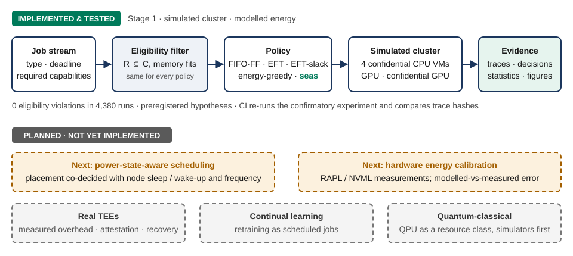
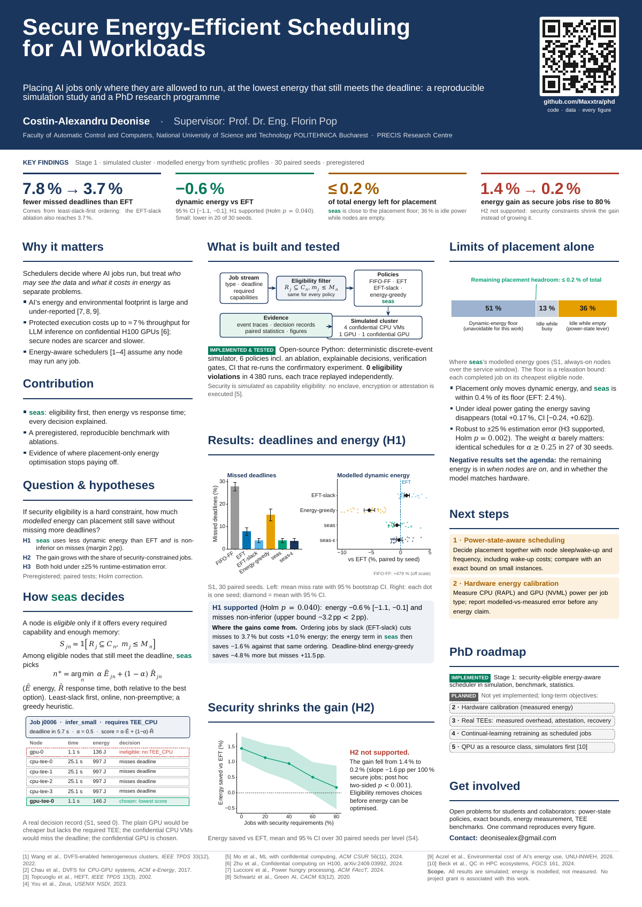

# seas — Secure Energy-Efficient Scheduling for AI Workloads

**PhD research, Stage 1.** Costin-Alexandru Deonise · Supervisor: Prof. Dr. Eng. Florin Pop
Faculty of Automatic Control and Computers, National University of Science and Technology POLITEHNICA Bucharest · PRECIS Research Centre

[](https://github.com/Maxxtra/phd/actions/workflows/ci.yml)
· Licence: Apache-2.0 · [Poster (A0 PDF)](poster/poster.pdf) · [All results](results/RESULTS.md)

## The problem

A scheduler decides where every AI job runs. Two questions are usually answered by different systems:
*may* this node see the job's data (does it offer the required trusted-execution capability?), and what
does running the job there *cost* in energy? Energy-aware schedulers generally assume any node may run any
job; confidential-computing work generally ignores placement energy. When both matter at once,
security-capable nodes are scarcer and slower, and it is not obvious how much energy-aware placement can
still achieve.

## Contribution (Stage 1)

1. **`seas`**, a Security-Eligible, Energy-Aware Scheduler: every job is first restricted to nodes that
   declare its required capabilities and have enough memory; among those that can still meet its deadline,
   it trades modelled energy against predicted response time, and records *why* each node was chosen or
   rejected.
2. **A reproducible, preregistered benchmark**: deterministic discrete-event simulator, five baselines and
   ablations sharing the same eligibility filter and expiry rule, paired seeds, hashed configurations,
   independent trace replay, and CI that re-runs the confirmatory experiment.
3. **Evidence about the limits of placement-only energy optimisation** under security constraints, which
   sets the agenda for the next stages.

<p align="center"></p>

> **What this is and is not.** Everything here is **simulated**. Energies are **modelled** from synthetic
> power/throughput profiles, not measured. Security is **simulated capability eligibility** (a job may run
> only on nodes that *declare* the capabilities it requires); no enclave, encryption or attestation is
> executed. Power-state control, hardware calibration, real TEE execution, continual learning and QPUs
> are **planned, not implemented**.

## Evidence (generated in [`results/RESULTS.md`](results/RESULTS.md))

Main scenario S1: 200 AI jobs, 50 % with security requirements; 4 confidential-CPU-VM nodes, 1 GPU node,
1 confidential-GPU node; 30 paired seeds; hypotheses preregistered in
[`docs/preregistration.md`](docs/preregistration.md) before any confirmatory run.

| Hypothesis | Outcome (Holm-corrected across H1–H3) |
|---|---|
| **H1** seas uses less dynamic energy than EFT *and* is non-inferior on deadline misses (2 pp margin) | **Supported** (p = 0.040). Energy −0.6 % [95 % CI −1.1, −0.1], lower in 20 of 30 seeds; misses 3.7 % vs 7.8 % |
| **H2** the energy gain grows with the share of security-constrained jobs | **Not supported.** Post hoc, the opposite: 1.4 % at 0 % secure jobs → 0.2 % at 80 % (two-sided p < 0.001) |
| **H3** H1's energy gain and a miss-rate advantage over energy-greedy survive ±25 % estimation error | **Supported** (p = 0.002) |
| H4 (descriptive) deadlines are binding | Yes: deadline-blind energy-greedy uses 4.8 % less energy than seas but misses 11.5 pp more deadlines |

What the numbers mean:

* **The miss-rate reduction comes from least-slack-first ordering.** The `eft-slack` ablation reaches the
  same 3.7 % (at +1.0 % energy); the energy term in seas then saves 1.6 % relative to that ordering.
* **Placement-only optimisation is close to its floor.** For the jobs it completes, seas's dynamic energy
  is 0.4 % above a relaxation bound (each job on its cheapest eligible node; EFT: 2.4 %). That headroom is
  ≤ 0.2 % of total always-on energy, whereas idle power while nodes are empty is ≈ 36 %.
* **Total energy.** With always-on nodes over the service window, dynamic energy is ≈ 51 % of the total and
  seas changes the total by −0.28 % [−0.53, −0.00]. Under ideal power gating the saving disappears
  (+0.17 %, CI −0.24…+0.62). Both are secondary, not preregistered (accounting in
  [MD-4/MD-7](docs/methodology_decisions.md)).
* seas completes 3.2 % more work, so its dynamic energy per unit of completed work is −3.6 % (secondary).
* The energy weight α hardly matters here: α ∈ {0.25, 0.5, 0.75, 1} gives identical schedules in 27 of
  30 seeds (energy within 0.01 %).

**Research consequence.** The remaining energy is in *when nodes are on*, and whether the model matches
hardware: power-state-aware scheduling and hardware energy calibration are the next steps.

<p align="center"><a href="poster/poster.pdf"></a></p>

## Reproduce

```bash
git clone https://github.com/Maxxtra/phd && cd phd
python -m venv .venv && source .venv/bin/activate
pip install -e ".[dev]"
pytest -q                                              # 25 tests, incl. property-based invariants
seas run configs/scenarios/S1.yaml --workers 2         # 6 policies x 30 seeds, about 10 s
seas explain results/S1/base/seas/seed_0 --job j0006   # why was this job placed there?
```

Every number and figure:

```bash
for s in S1 S4 S7 S2 S3 S5 S6 E-load; do seas run configs/scenarios/$s.yaml --workers 2; done
seas scaling            # exploratory wall-clock benchmark (slow, machine-dependent)
seas analyze            # summaries, paired tests, confirmatory evaluation -> results/CONFIRMATORY.json
seas verify             # eligibility, capacity, memory, conservation, preregistration hashes, determinism
seas report             # results/RESULTS.md and poster/generated/results.tex
seas plot               # figures/*.pdf|svg and figures/MANIFEST.md
cd poster && xelatex poster.tex && xelatex poster.tex
```

Re-running reproduces the committed event traces bit for bit (checked with `trace_sha256`); CI does this
for S1 on every push.

## Roadmap

| Stage | Status | Goal |
|---|---|---|
| 1 · Security-eligible energy-aware placement | **Implemented, simulated** | This repository |
| Next · Power-state-aware scheduling | Planned | Decide placement together with node sleep/wake-up and frequency, with wake-up costs; exact bounds on small instances |
| 2 · Hardware energy calibration | Planned | RAPL/NVML measurements per job type; modelled-vs-measured error |
| 3 · Confidential and resilient execution | Planned | Real TEEs: measured overhead, attestation, checkpoint/recovery |
| 4 · Continual-learning-aware scheduling | Planned (long term) | Retraining triggered by drift, scheduled as jobs |
| 5 · Quantum-classical resources | Planned (long term) | A QPU resource class, simulators first |

## Contribute

Good entry points, each small enough for a student project (details in [CONTRIBUTING.md](CONTRIBUTING.md)):

* **Power states** — a policy that accounts for idle power with a wake-up cost model.
* **Optimisation** — an exact CP-SAT bound for ≤ 40-job instances and the optimality gap of seas.
* **Calibration** — measure throughput and power with RAPL/NVML on real hardware.
* **Security** — measured TEE overhead per job type; a richer capability model.
* **Workloads** — drift-triggered retraining streams; a QPU node class (schema first).

Open an issue to discuss an idea, or contact deonisealex@gmail.com.

## Repository map

```
seas/                 package: models, estimators, sim (engine), policies, experiments, viz, cli
configs/              clusters (synthetic profiles), workloads, scenarios (S1/S4/S7 confirmatory, frozen)
docs/                 methodology_decisions.md, preregistration.md, model.md, assumptions.md, references.bib
results/              runs.csv, summary.csv, pairwise.csv per scenario; RESULTS.md; CONFIRMATORY.json
figures/              vector PDF/SVG figures + MANIFEST.md (figure -> source data -> commit)
poster/               poster.tex (A0), poster.pdf, poster_preview.png, generated macros
tests/                unit, policy scenarios, property-based invariants, statistics, CLI
```

Per-run traces are regenerated by `seas run`; only the seed-0 traces used by figures are committed.

## Methodology in one paragraph

Jobs are generated once per seed and shared by all policies (paired design, common random numbers). Every
policy sees only security- and memory-eligible nodes, and the same expiry rule drops waiting jobs that can
no longer meet their deadline, so no baseline can win by violating a constraint
(`eligibility_violations = 0` in all runs, checked by independent trace replay). The arrival rate was set a
priori from workload and cluster parameters only. Non-inferiority uses a one-sided paired *t*-test with a
2 pp margin; superiority uses one-sided Wilcoxon signed-rank tests; Holm correction across H1–H3; effect
sizes as matched-pairs rank-biserial correlations and bootstrap CIs. Every deviation from the original
plan, including a post-hoc correction of the secondary idle-energy accounting found in audit (MD-7), is
documented in [`docs/methodology_decisions.md`](docs/methodology_decisions.md).

## Limitations

1. Simulation only; synthetic, uncalibrated profiles; energies modelled.
2. Simulated security eligibility; no TEE, encryption or attestation; side channels out of scope.
3. Additive power model without contention between co-located jobs.
4. Independent, non-preemptive jobs; no failures; one cluster; simple data-staging model.
5. Online greedy heuristic; only a relaxation bound on dynamic energy, no exact optimum.
6. Python implementation; decision time grows with queue length × nodes (exploratory scaling only).

## Citation

See [CITATION.cff](CITATION.cff).
